# 手术通知 APP 页面流程 v0.5

> 状态：当前有效页面流程
> 日期：2026-08-19
> 页面依据：[业务员APP页面清单 v0.5](./01-业务员APP页面清单-v0.5.md)
> 规则依据：[手术通知APP核心业务规则 v1.2](../01-规则池/01-手术通知APP核心业务规则-v1.2.md)、[O01—T任务编排规则 v0.1](../02-接口池/01-O01-T任务编排规则-v0.1.md)、[订单中心APP集成规则 v1.1](../02-接口池/02-订单中心APP集成规则-v1.1.md)
> 范围：确定页面进入、分支、返回、汇合、跨模块跳转和异常恢复；不确定页面布局、控件形态、视觉样式和Figma稿。
> 替代：[手术通知APP页面流程 v0.4](../06-决策与历史池/2026-08-16-手术通知APP页面流程-v0.4.md)

> 当前收口：C组六页集合继续有效；O组剩余页面宏观审查删除O03独立身份后，APP正式页面总数为17页。本文件只冻结逻辑连线，不代表未讨论页面的单页结构已经设计。

## 1. 页面流程总原则

### 1.1 围绕业务员当前动作走

业务员可以从首页、订单详情、全局任务中心或系统提醒直接进入当前需要处理的页面，不要求为了完成一个动作逐层穿过模块目录。

### 1.2 三种东西必须分开

- 订单主状态：整张订单总体走到哪里；
- 当前任务：此刻是否必须由业务员本人行动；
- 普通结果：公司或其他模块已经形成、业务员只需按需查看的信息。

状态变化不自动跳页，普通结果不制造任务，任务完成也不等于订单完成。

### 1.3 返回后保留工作现场

- 创建过程在产生实际输入后先在本机持久保存草稿，公司端同步独立进行；仅进入空白C02不生成可见草稿；
- 从选品、器械、备注等子页返回时，回到原编辑上下文并保留选择；
- 从O01进入任务，处理后返回原O01；
- 从G03进入任务，处理后恢复G03原筛选、排序和滚动位置；
- 从列表进入详情，返回时恢复原页签和列表位置；
- 从外部模块返回时回到发起跳转的订单或任务上下文。

### 1.4 一台手术不是一条单线流程

同一手术需求组可以分批履约、分批交付、部分植入，并把剩余实物分别转入个人仓、转入本人其他订单、还回公司或进入异常处置。多个去向可以并行、分次发生，最终统一汇总到O01；S组只承载具体动作，不再建立第二张责任总览。

### 1.5 不把后台内部流程带进APP

货源仓、采购、借入、调拨、配货、同行协作和供应商退货不形成APP页面。只有影响业务员最终使用结果、需要本人行动的事项才进入任务。

### 1.6 防止业务员被频繁打扰

- 普通进度留在订单详情；
- G02订单卡最多显示一项必要提示；
- O01没有任务时隐藏任务区；
- 只有逾期、阻塞手术或明显责任风险才形成强提醒；
- 排序优先级与是否推送分开判断。

## 2. 全局入口

底部导航固定为G01首页、G02订单中心和G04我的。G03是唯一跨模块任务中心，但不是底部导航项。C00是G01下的二级页，顶部返回G01；C00、C02、C03、C09、C10和C11均不显示全局底部导航。

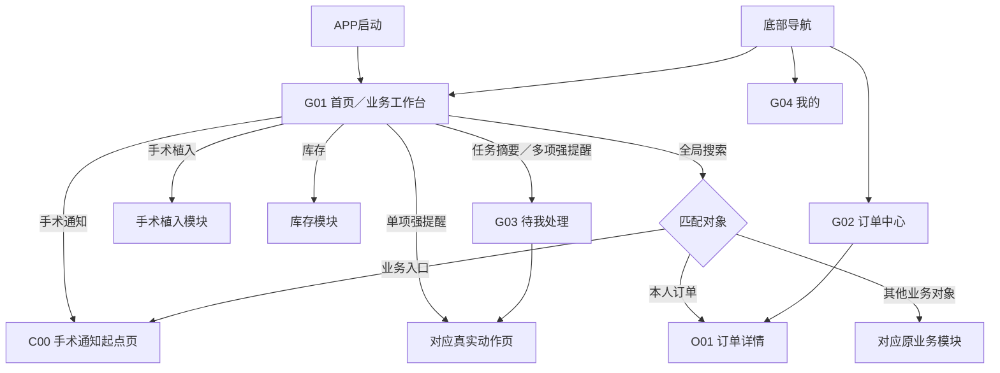

全局搜索只提供快捷导航，不建立独立业务事实或第三套订单列表。G04本阶段只保留设置型管理外壳。

## 3. 手术通知总体流程

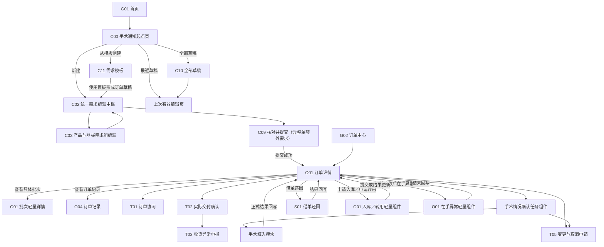

G01“手术通知”始终进入C00，不根据草稿有无直接跳转C02。没有订单草稿时，C00隐藏整个“继续未完成”区域，仅保留空白新建与从模板创建；不增加订单、任务、统计、教程或未来不可用功能填充页面。

总图只表达主要连接关系，不表示所有页面必然依次经过。具体条件、返回位置和等待状态以下列PF线路为准。

C11进入后默认先解决“选择模板创建需求”：公司共享模板与已下载模板位于同一主层，以“已下载／公司模板”轻量切换；有已下载模板时默认前者，没有时直接显示公司模板。两类模板只使用“使用模板”一个主动作并进入同一套C02／C03／C09订单创建链，不拆分“直接使用／调整使用”。“我的模板申请”作为同页低频次级层，承载模板候选创建／续编及本人申请结果；不把四类内容拆成四条并列主流程。

模板卡片使用模板名称、已有医院／科室／术者、紧凑产品与器械摘要及必要可用状态完成识别；搜索覆盖上述文字信息与产品／器械名称，不增加高级筛选。点击卡片在C11内打开轻量详情，不新建正式页面；也可直接使用模板进入可编辑C02。完整需求摘要的具体组配表达等待C02／C03方案回补。

公司模板和已下载模板可以添加同一条账号私有、设备缓存的个人备注；无需下载即可添加，移除下载不删除，个人备注可以参与本人侧搜索。备注不修改模板、不进入审核，也不自动带入订单或模板候选；不得记录患者信息。

模板候选必须填写模板名称并至少包含一个产品或器械需求组；适用医院、科室、术者和固定要求可选。订单成功后创建候选时不自动复制原订单整单额外要求；使用模板创建订单时，固定要求预填C09并由业务员针对本次重新核对，个人备注不带入。

模板候选以首次本机持久保存成功作为进入C11“未完成”的形成点；空白进入后直接退出不制造空记录。候选允许离线保存和待同步，但正式提交公司审核必须联网，在C02模板态直接完成并防止重复提交，不经过C09。C11来源提交成功后返回C11“审核中”，O01一次性提示来源提交成功或退出后返回来源O01；已保存未提交候选仍可从C11继续，退回重提沿用同一申请身份。

## 4. PF01 新建手术通知

### 4.1 主路径


提交成功后给予明确的短反馈并进入O01，不单独建立“提交成功页”。

### 4.2 需求编辑往返

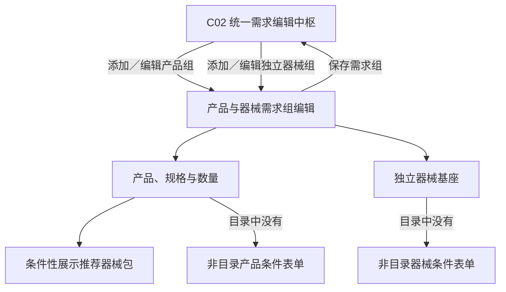

流程规则：

- 产品和器械可以单独申请；普通订单草稿和模板候选不能同时为空。补充来源可以在两者均为空时进入C09，但必须填写“本次补充要求”后才能提交；
- C02在订单来源态下承载医院、科室、术者、手术日期和准确时间；补充来源态继承原手术场景并只读，模板候选编辑态不显示具体手术日期与时间；这些只是同一编辑器接收的来源上下文，不是独立页面；
- 五项手术信息直接在C02内展开，不增加编辑子页；复制来源的医院、科室和术者可以带入并修改，日期与准确时间留空重填；C02不增加医院、科室或术者的维护与绑定功能；
- 复制或模板带入的医院、科室、术者失效时保留来源原文；可重新匹配则由业务员选择，仍无适用项时可以标记“请公司确认”并继续到C09；该例外不向空白新建开放，C09必须继续显示待确认事实；
- C02标题下只对模板创建、复制需求、撤回修改和补充显示紧凑来源说明；空白新建不显示来源，模板候选标题使用“编辑需求模板”；来源提示不展开为状态卡或历史详情；
- C02按“本次手术信息—产品与器械需求摘要—添加产品／添加器械基座—底部主操作”组织，不设步骤条或完成百分比；订单草稿从底部进入C09，模板候选直接提交审核且不进入C09；
- 每次完成一种产品的规格和数量后回到C02汇总，不强迫连续选择下一种；
- C02需求组摘要只保留产品／器械名称、规格数量、已采用配套器械及适用标识；整卡进入C03；低强调移除后提供短暂撤销，撤销窗口结束再固化自动保存；移除后添加基座仍保留；补充来源只展示本次新增组；
- 是否采用系统推荐器械包由业务员自主选择；查看标准组成本身不改变选择，推荐不自动加入；
- 明确采用推荐器械包后形成一条带来源产品关联的独立器械需求组；它可以跟随产品摘要展示，但可以单独编辑或移除，移除器械不影响产品；手动或非目录器械也可以不关联产品独立存在；
- 非目录产品和非目录器械由综合载体内不同条件表单承接，必须保留需求类型和原始描述；
- 业务员可以多次往返C02，完成后自行进入C09；整单额外要求在C09直接填写或修改。
- C02进入下一层前只检查手术信息、需求组级完整性、失效资料处置及来源状态权限；主按钮不灰置，失败后集中提示、轻量标记并定位第一项；C09继续执行全量核对、重复提示、额外／补充要求和最终权限版本校验；
- C02／C03的最终需求摘要、目录查找、多规格数量、器械合并去重和非目录字段等待统一组配方案后回补；当前只继承“C03输出编辑完整需求组、C02汇总并进入C09”，不以占位流程推断具体组配交互；

### 4.3 修改、失败和退出

- C09各内容区可以回到对应页面修改，保存后重新回到C09；
- 除整单额外要求／本次补充要求外，C09手术信息和需求内容均只读；不同来源分别使用“提交订单”“提交补充订单”“重新提交订单”，成功后直接进入新O01、来源O01或原O01，不增加成功页；
- 新主订单首次提交成功进入O01后可以一次性低强调显示“创建需求模板”；点击后复制结构化需求进入模板候选编辑，关闭或离开后消失；补充和撤回重提不显示，O01不建立永久入口；
- 校验失败停留在C09，指出具体问题并提供回到相应页面的入口；
- 疑似重复只提醒，不阻止继续提交；
- 网络失败或重复点击不得产生两张订单，当前输入和草稿必须保留；
- C02、C03和C09中途退出先完成本机持久保存，不视为放弃；未同步草稿可以退出和恢复，离线时不能正式提交；
- 正式提交使用唯一业务请求标识，防止重复订单。

## 5. PF02 草稿与订单需求复用

### 5.1 继续草稿


- C10只负责查找、继续和按草稿身份退出，不放置“新建手术通知”按钮；
- C10以“可继续／无法继续”组织一个草稿列表，不按来源拆标签页；来源只作为卡片标识。可继续草稿按最后一次本机保存时间倒序，无法继续草稿位于底部次级区域并显示原因；
- 卡片整卡恢复上次有效编辑位置，低频动作进入更多；搜索只覆盖医院、术者、手术日期和关联订单号；普通草稿及未提交补充草稿可确认删除，撤回原单只能继续修改或正式取消订单，撤回补充单只能继续修改或正式取消本次补充；
- 没有任何订单草稿时，C00隐藏最近草稿和全部草稿组成的整个继续区，但G01入口仍固定落在C00；
- C00最近草稿整卡点击后恢复上次有效编辑位置，不另设“继续”按钮；删除和其他管理动作统一在C10办理；
- 首次实际输入在本机持久保存成功后，空白创建才进入可见草稿集合；模板、复制、补充和撤回修改等已带入有效内容的来源本机保存成功后直接进入；多张草稿按内容最后一次本机保存时间倒序，第一张显示在C00；公司端同步时间不改变排序，尚未同步时低强调标记“待同步”；
- 最近草稿只从当前可继续的草稿中选择；失效草稿不静默删除，同时存在有效草稿时只留在C10，仅剩失效草稿时C00不显示最近卡片，只显示低强调的“有草稿无法继续，查看全部草稿”入口；
- 编辑链记录进入来源：C00直接进入时退出回C00；C10恢复草稿时退出回C10并恢复列表位置；C11使用模板形成订单草稿后退出回C00，不退回模板选择页；C03／C09内部返回先回C02，退出C02时再回来源页；
- 继续草稿恢复上次有效编辑位置，不一律从C02总览开始；
- 删除草稿需要二次确认，删除后留在C10并恢复原列表位置；
- 草稿来源包括空白新建、模板创建、当前／历史订单“复制需求新建”、待受理订单撤回和已受理订单尚未提交的补充需求；
- 补充需求草稿在C00、C10和来源O01引用同一草稿；同一订单同一业务员同时只保留一张有效补充需求草稿；
- 补充需求草稿明确显示关联订单，但不进入G03或形成待办；重新进入或提交时按当前订单状态和权限重新校验。

### 5.2 复制需求新建


- 只在来源O01存在可复用的正式需求快照时显示入口；带入当前正式有效的医院、科室、术者、产品和器械需求；
- 新手术日期和准确时间必须重新填写；
- C02按产品需求组、器械需求组及其他适用需求展示复制内容；产品组或器械组可以整组移除，但清空后继续保留“添加产品／添加器械”的空基座；
- C02是复制草稿的编辑中枢；修改产品、器械或非目录内容时进入C03产品与器械需求组编辑，整单额外要求进入C09，不复制一套新页面；
- 非目录需求、特殊器械和整单额外要求必须重新核对；
- 当前基础信息已经停用、删除或无法映射的项目进入“复制需求待核对”，不静默丢弃；
- 不复制原订单身份、状态、履约、批次、实物、植入、本单物品结余、异常和任务；
- 不同手术必须形成不同订单；本操作不是原订单补充单，不能用一个订单同时承载两台手术；
- 来源订单的具体在手产品或器械不自动进入新草稿；C09提交形成明确新订单后，确需继续使用的实物再按正式转用规则关联两张订单；
- 公司共享模板与复制需求新建并存：模板从C00进入C11，复制需求仍从来源O01进入C02。

### 5.3 公司共享模板与下载复用（宏观已确认）

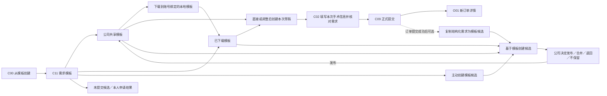

- 下载模板绑定业务员账号并缓存到设备，不形成脱离系统的文件；
- 下载副本保留公司模板来源与版本，删除副本不影响共享库；
- 候选未获发布前不能重复作为模板使用，但当前订单草稿可以正常提交；
- 模板候选既可从模板载体主动创建，也可在订单正式提交成功后复制本次结构化需求生成；正常订单编辑和提交核对不被模板动作打断；
- 模板候选复用C组编辑能力的模板模式，不携带具体手术日期与时间，不进入C10；未提交候选和本人申请结果均从模板载体继续或查看；
- C11“我的模板申请”使用一个列表：“未完成”中的未提交与退回待修改优先，审核中其次，已发布／已合并／未保留／已放弃结果位于末端并默认收起；
- 未提交候选可以继续或删除；退回申请可以修改重提或正式放弃并保留历史；审核中只读，不允许编辑、删除或撤回；
- 模板未提交、退回待修改和审核中均不进入G03，C11只显示低强调的未完成数量；普通系统通知方式留到统一通知规则阶段；
- 空白候选只有在实际输入本机保存成功后才形成，带入候选以带入内容首次本机保存成功为形成点；候选可离线保存但只能联网提交公司审核，失败保留内容且不得重复形成申请；
- C11来源候选退出或提交成功返回C11并恢复相应位置；O01一次性提示来源返回原O01，已保存候选以后从C11继续；提交成功不新增成功页，退回重提沿用同一申请身份；
- 模板管理不进入G04“我的”，O01不提供保存为模板；
- 审核角色、Web页面、额度、付费和发布治理留到后台阶段。

### 5.4 植入取出未来分支

植入取出是患者既往植入手术后，为新的取出手术向公司提出工具等需求的未来创建来源。当前只预留C00／手术植入模块到共用创建链的接口，最终仍生成独立订单并进入O01；患者、原植入物、取出工具匹配和手术植入内部页面均留到手术植入模块审查。当前C00不显示不可用入口。

## 6. PF03 补充单、撤回与正式变更

### 6.1 发起补充单

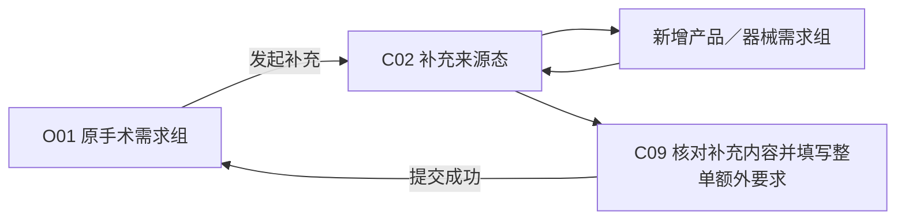

- 补充单继承原手术场景，C02内手术信息区只读；
- 尚未提交时只形成一张关联原O01的补充需求草稿；中途退出后可以从原O01、C00最近草稿或C10恢复同一草稿；
- 同一订单同一业务员再次点击补充需求时继续原草稿，不重复创建；
- 补充单只新增需求，不覆盖原订单已经生效的内容；
- 补充单可以只包含与本次手术履约直接相关的“本次补充要求”；没有新增产品／器械时该字段必填，仍形成具有独立编号和受理结果的接续订单；不得借此提交T05范围内的正式变化或替代T01；
- 正式提交前重新校验当前订单状态和权限；状态已经不允许补充时阻止旧草稿提交并说明原因；
- 提交后回到同一个O01，G02不增加一张同级订单卡；
- 原单和补充单仍分别编号、处理和审计。

### 6.2 待受理撤回

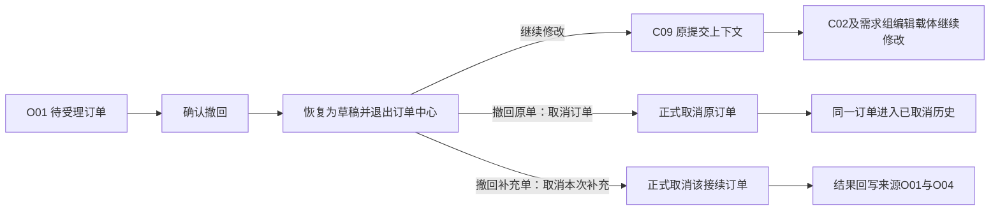

只有待受理阶段可以直接撤回。撤回后恢复为草稿，不把正式订单原地开放编辑；该草稿同时可以在C10中找到。

- 原单撤回后保留原订单编号和手术需求组身份，暂时退出订单中心；重新提交后恢复同一O01，只新增当前提交版本；
- 补充单撤回后保留该补充单自己的编号，重新提交只更新该补充单版本，不影响原单和其他接续订单；
- 首次提交、撤回、修改和重新提交的内容与时间永久留痕；撤回期间草稿没有订单主状态，重提成功后恢复“待受理”；
- 撤回修改稿不提供普通删除：原单只能继续修改或正式取消订单，补充单只能继续修改或正式取消本次补充；
- 原单取消成功后保留同一订单身份并进入已取消历史；补充单取消只结束该张接续订单并回写来源O01与O04，不影响原单和其他接续订单；
- 如果公司受理先成功，撤回动作失效并刷新最新订单事实，不能继续进入草稿编辑。

### 6.3 正式变更与取消


- 正式提交后的医院、科室、术者、时间、需求减少、停止剩余和订单取消都通过T05提请；
- 同一现实事件引起的多项相关变更可以在一份申请中同时选择，各项分别展示变更前后内容并分别回写结果，共用一次事件原因；
- “取消整单”必须独立提交，不与其他变更项混合；手术延期可以携带同一事件引起的医院、科室或术者变化；
- 业务员提交申请不直接改写当前生效内容；
- 提交后只等待公司时不继续占据待我处理；
- 后台返回新问题时，根据真实动作生成新的任务或协同版本。

## 7. PF04 订单中心、详情与任务入口

### 7.1 正常浏览

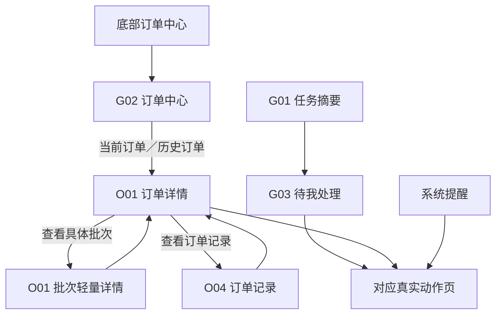

O01内部采用以下固定阅读顺序：

```text
待我处理（存在时）
→ 订单编号
→ 基本信息＋一个主状态
→ 订单内容（主订单＋接续订单）
→ 发货与接收（整单或分批）
→ 当前可执行操作
→ 订单记录入口
```

原O02职责已经融入O01订单内容。订单构成和实物交付是两个维度：主订单／接续订单说明需求来源，整单／批次说明实际发出和接收事实，同一批次不得在多个单据下复制。

G02只分当前订单和历史订单，不设置“全部订单”或“待我处理”页签。每张卡只有一个主状态和最多一项必要提示，点击整张卡先进入O01。

### 7.2 O01动态任务

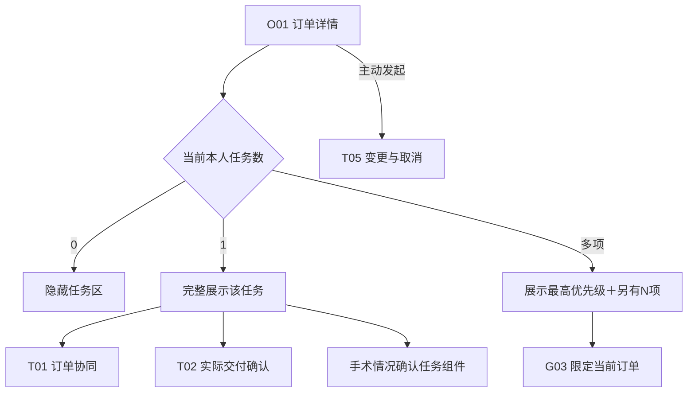

- T03只从T02进入，不直接占据O01任务区；
- 手术情况确认任务直接提供记录手术植入、延期和取消，不再进入独立T04页面；
- T05主要是业务员主动操作，或承接手术情况确认任务的延期／取消；
- 植入和待结余本人任务可以出现在G03或O01；总览进入O01待结余位置，明确动作进入对应S页；
- G02只显示必要提示，不在订单卡叠加第二个直接处理按钮。

### 7.3 当前与历史

- 当前订单：待受理、处理中、待发货、已发货、发起追回、待结余；
- 历史订单：已完成、已取消；
- 计划时间到达不自动改变主状态；
- 部分发货、部分接收、补充单差异和还回阶段不新增列表状态；
- 当前／历史订单的“复制需求新建”只在O01提供，不挤入G02卡片。

### 7.4 终局、更正与重新打开

- 已完成、已取消进入历史订单，但原O01和O04身份继续保留；
- 不产生新责任的历史更正只进入O04并保持原终局、终结时间与历史归类；
- 重新产生有效需求、实物流、数量差异或本人责任时，必须先形成正式重新打开记录，再沿用同一O01回到当前订单并按当前有效事实重算主状态；
- 重新打开后才能生成新的本人任务，不能从O04历史详情恢复旧任务或旧操作；
- 再次完成或取消时，形成新的终局记录；较早终局、更正和重新打开关系继续留在同一O04倒序时间线；
- 手术取消但存在实物责任时继续按当前事实处理，责任闭环后进入“已完成＋手术已取消”，不提前进入已取消。

## 8. PF05 订单协同

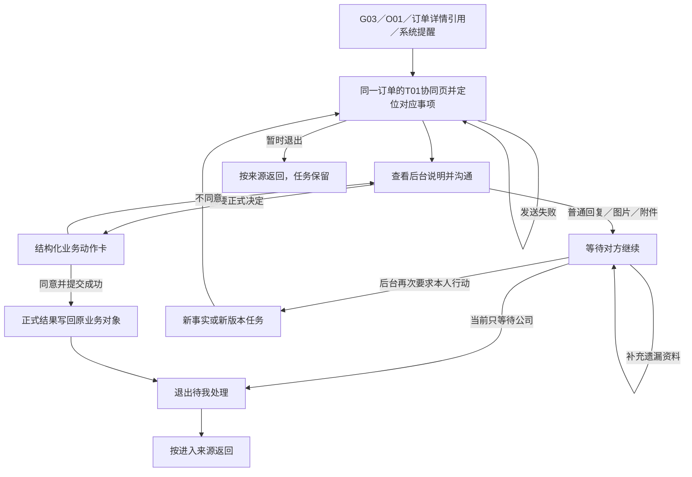

T01不再要求业务员识别“替代、规格、数量、非目录、时间或交付安排”等后台分类。

- 后台在当前条件下不能直接继续，需要业务员补充、沟通或决定时发起；
- 业务员不能在没有公司协同事项时主动创建聊天；
- 同一手术需求组只建立一张T01页，多个公司协同事项分别保留任务和状态；从入口进入时直接定位对应事项；
- T01一次只展开一个事项及其对话，其他有效事项通过“另有N项协同”切换，不合并不同事项的消息流；
- 单个事项只回答“这是哪台手术的订单、公司现在要本人做什么、本人现在可以怎么处理”；订单语境、变化、影响、期限和历史只在当前动作确有需要时显示；
- 普通聊天内容只作辅助，不能直接改变正式订单事实；
- 正式变化必须由结构化业务动作形成；
- 同意当前方案并明确提交后才写回正式结果；不同意时订单事实不变并回到本事项继续协同；
- 不同意不自动取消、不发起订单变更，也不替代T05；
- 本人完成当前要求后只等待公司时退出待办；原事项可以补充遗漏资料，但不能新开沟通主题；
- 公司正式结束、撤回或替代事项后，原事项只读；
- T01不能代替T02、T03、手术情况确认任务、T05、手术植入或待结余实物处理；
- 内部货源变化和纯知晓信息不进入T01；
- 提交失败保留输入并允许安全重试；
- 同一事项不同入口引用同一任务，不重复生成。

## 9. PF06 分批交付、批次确认与收货异常

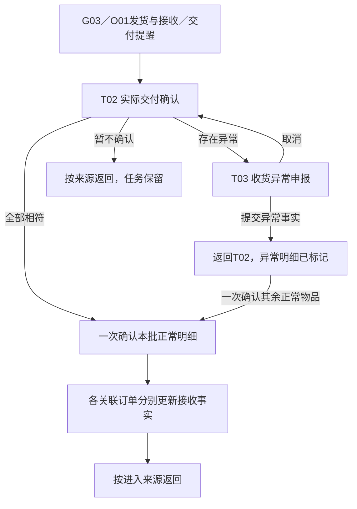

- T02按公司建立的一次实际交付批次组织，可以关联同一业务员的一张或多张订单；
- 业务员不能自行拼接没有共同交付关系的订单；
- 后台发货、物流或交接签收、业务员本人确认接收是三个独立事实；
- 正常明细可以确认，异常明细不能被同一次确认掩盖；
- 全部相符时整批一次确认；存在异常时先申报异常明细，再一次确认其余正常物品；不逐项勾选正常，不按关联订单分别确认；
- 未实际收到的异常部分不形成本人在手责任；实际到手但异常的部分形成临时在手责任并冻结；同一明细部分正常、部分异常时按数量拆分；
- 所有明细已有明确结果后T02完成；未闭环异常留在O01对应交付事实并阻止订单完成，不继续占据T02待办；
- T03只处理确认接收前、实际交付现场发现的异常；
- 公司在业务员接收前成功拦截时，只更新O01发货与接收区域及对应批次轻量详情，不要求业务员收货或还回；
- 本人确认接收后建立在手责任，之后发生或发现的异常回到O01并打开在手异常轻量组件；T03与该组件只共享表单能力，不合并业务语义或责任判定。

## 10. PF07 手术时间到期后的结果衔接

计划手术时间到达或已经过去，不自动把订单标记为已进行、延期、取消或待结余。

G01继续保留手术植入模块入口。O01／G03中的订单上下文入口负责直接定位同一台手术并携带候选实物；计划时间到达前，在订单仍可关联该台手术且尚无正式结果时，O01可以低强调显示“记录手术植入”，到达计划时间仍无结果时再升级为手术情况确认任务。

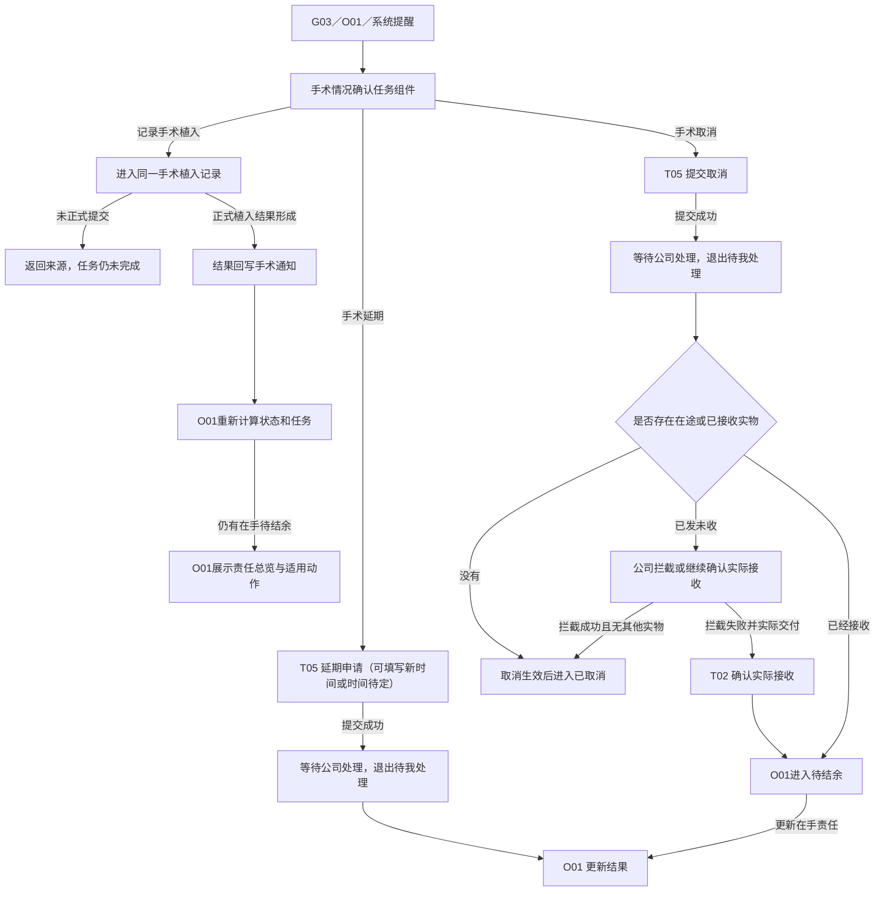

已进行路径：

- 跳转时携带来源手术通知并定位同一植入记录；
- 手术通知已交付物只作为候选，默认不全选；
- 患者信息、住院号和实际植入明细在植入模块采集；
- 进入过植入页面不等于结果已经形成；
- 有效植入结果正式提交后，手术情况确认任务才完成；
- 结果先回写O01，不强制业务员立即进入S页；只有仍有实物待结余时，O01展示责任总览，O01或G03再提供具体动作入口。

延期与取消：

- T05保持一张页面；从O01主动进入时先选择当前允许的申请事项，从任务组件进入时直接定位已经选择的延期或取消模式；
- 同一事件的相关变更可以合并申请；取消整单保持独立，不与其他变更项混合；
- 延期时，已知新时间则填写新的日期和准确时间；未知时可以提交“时间待定”；
- 延期正式生效后，旧计划时间失效，不再依据旧时间重复产生手术情况确认任务；新时间确定后再通过T05提交；
- 延期不自动进入待结余，订单和已接收实物继续绑定同一台手术；
- 尚未发货的剩余需求由后台处理停止；
- 已发未收先由后台尝试拦截，成功拦截不形成业务员还回责任；
- 已经由业务员确认接收的实物必须进入本单物品结余，不能因取消自动解除责任。

## 11. PF08 本单物品结余的并行去向

### 11.1 责任关系

产品按数量守恒：

```text
实际接收数量
= 实际植入数量
+ 批准转个人仓数量
+ 批准转本人其他订单数量
+ 公司确认还回数量
+ 批准异常处置数量
+ 在手待结余数量
```

器械包按具体包编号、完整性和可用结果逐包管理，不能与产品件数合并为一个总数。

O01的展示结构继续以原整单／交付批次／出货清单为主轴，植入、入库、转用、异常和还回结果叠加到原交付明细；不按结果重建第二套清单。结果汇总只承担快速概览和定位，具体数量与实物仍回到来源批次和明细。

- 产品明细可以在一行内紧凑汇总多个结果数量，展开后查看具体批次、数量或实物；
- 器械包按具体包编号逐包显示结果；
- 还回、申请入库、申请转用和申报异常入口集中位于本单物品区末端，并显示当前符合条件的数量；
- 点击集中入口后选择符合条件的具体物品；从单条明细进入时只预选该物品，不另建第二套办理流程；
- 明细行不重复平铺同一组主操作按钮，返回O01后重新计算结果、数量和可操作资格。

### 11.2 页面流程

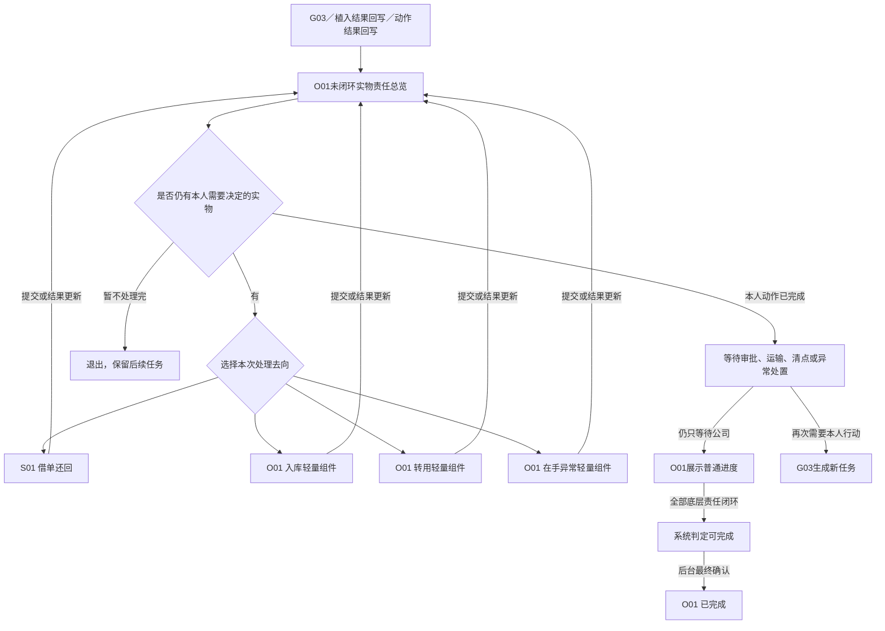

- 不同实物可以选择不同去向，各项动作没有固定先后；借单还回使用独立页面，入库／转用与在手异常由O01相应轻量组件承载；
- 同一订单可以分多次处理；
- 提交申请只表示进入审批或处置，不立即解除责任；
- 业务员完成本人动作、只等待公司时，任务退出G03，但底层责任仍可能阻塞订单完成；
- O01和S01均不设置业务员“完成订单”按钮；
- 订单完成还要满足需求、交付、植入或取消、数量守恒和后台最终确认。

## 12. PF09 本人订单转用与消毒衔接

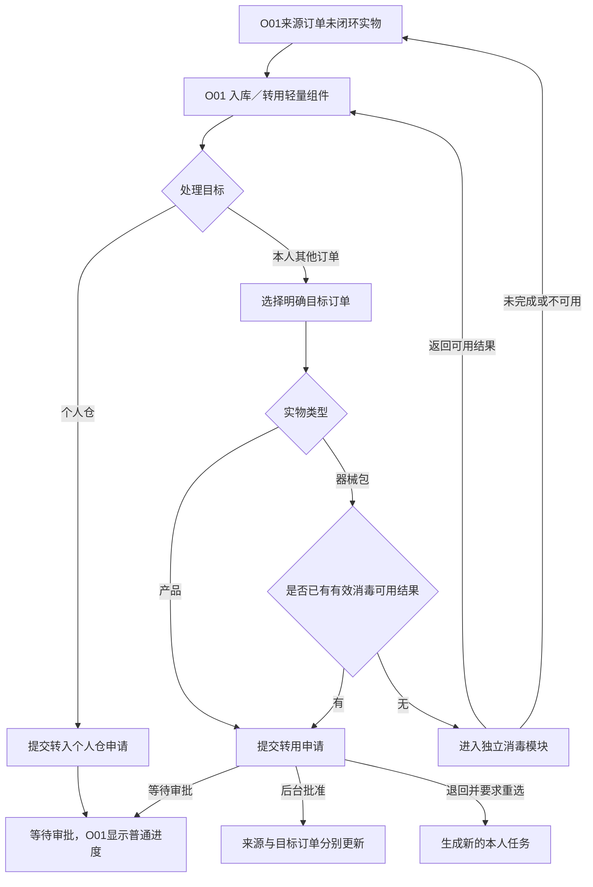

- 转入个人仓和转到本人其他订单是O01轻量办理组件的两种目标模式，不建立独立正式页面；
- 目标只能是同一业务员本人的明确有效订单；
- 产品落实到具体可追溯实物和数量，器械包落实到具体包编号；
- 没有明确目标订单时不能使用转用；
- 待审批时责任仍在来源订单，相关实物锁定；
- 严禁跨业务员转用；
- 等待审批和正式结果在O01原物品行呈现；需要本人补办时从任务入口重新打开同一组件；完整记录归入O04；
- 消毒是独立模块，O01轻量组件只读取必要结果。

## 13. PF10 借单还回与合并交接

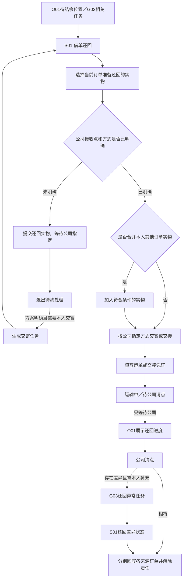

- S01属于原手术通知待结余下的还回分支，不形成首页独立模块；
- 一次寄送可以合并本人多张订单的还回实物；
- 合并的是物流交接，原订单、实物身份和责任仍分别存在；
- 接收方只能是公司指定接收点；
- 交寄后实物冻结，公司清点前不计入已还回；
- 运输中和等待公司清点不是业务员任务；
- 公司清点差异留在S01，不与T03或O01在手异常组件混用；
- 公司后续入库、调拨或退厂家属于Web后台流程。

## 14. PF11 在手实物异常

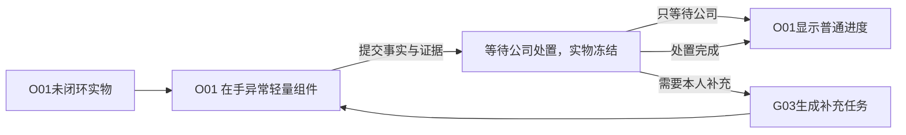

- 适用于本人确认接收后发生或发现的破损、污染、遗失、过期、包装或标签失效等；
- 申报后相关实物不能同时植入、转个人仓、转用或还回；
- 业务员只申报事实并查看结果，不自行判断报损、核销或责任归属；
- 公司正式处置完成后，O01更新责任结果；
- T03与O01在手异常组件可以复用实物选择、数量、说明、照片证据和提交反馈能力，但不合并入口、责任回写或返回路径。

三类异常必须分开：

| 异常发生点 | 使用页面 |
|---|---|
| 实际交付当场、本人确认接收前 | T03 |
| 本人确认接收后、实物在手期间 | O01在手异常轻量组件 |
| 本人交寄还回后、公司清点发现 | S01还回差异状态 |

## 15. 通用返回、退出与恢复

### 15.1 来源感知返回

| 进入来源 | 动作完成或退出后的默认返回 | 必须保留 |
|---|---|---|
| G01任务摘要或单项强提醒 | G01 | 首页工作现场和最新任务摘要 |
| G02订单列表 | G02原位置 | 当前／历史集合、搜索、筛选、排序和滚动位置 |
| G03待我处理 | G03原位置 | 筛选、排序、滚动位置；完成任务退出当前列表 |
| O01 | 原O01 | 原订单、展开区域和剩余任务 |
| O01发货与接收进入T02 | 原批次位置 | 当前批次上下文 |
| T03 | 固定返回原T02 | 原批次和已标记异常明细 |
| 手术情况确认任务进入T05 | 返回任务最初来源 | 来源订单或任务上下文 |
| 手术情况确认任务进入手术植入 | 返回最初来源或O01 | 同一植入记录和来源订单 |
| O01进入独立还回载体 | 返回原O01 | 来源订单和当前未闭环实物位置 |
| O01入库／转用轻量组件 | 关闭或返回原O01 | 来源订单、已选实物和当前办理结果 |
| O01在手异常轻量组件 | 关闭或返回原O01 | 来源订单、当前异常实物和办理结果 |
| 系统推送或无来源深链 | O01 | 关联订单及动作后的结果 |

系统返回键和页面返回按钮返回业务上的上一层，不无故跳回首页。

### 15.2 创建与表单恢复

- 产品与器械需求组编辑完成或返回后回到C02；
- C09进入修改页，保存后回到C09；
- O01批次轻量详情关闭后恢复原批次位置；O04返回O01；
- 未提交的创建、异常、变更和还回表单保留本机草稿；
- 网络中断、APP切后台或意外退出后恢复最近有效步骤；
- 加载失败与暂无数据必须区分，并提供明确重试或返回路径；
- 已经成功提交的正式事实不能通过返回键回滚。

### 15.3 防重复与重要确认

- 正式提交使用唯一业务请求标识；
- 重复点击不能产生重复订单、确认、申请、异常或交寄记录；
- 删除草稿、撤回、取消和确认接收等重要动作需要明确确认；
- 提交中、成功和失败必须有清楚反馈；
- 失败后保留用户已填写内容，允许安全重试。

### 15.4 深链与跨模块

跨页面或跨模块至少携带：

- 当前公司和业务员；
- 来源订单或聚合引用；
- 来源对象及版本；
- 任务ID；
- 来源页面与返回目标。

原模块重新校验权限和有效版本。同一任务不因多个入口重复生成，跨模块只交换必要结果，不复制完整流程。

## 16. 17个正式页面覆盖检查

| 页面组 | 页面 | 主要进入流程 |
|---|---|---|
| G | G01 | 全局入口、任务摘要、搜索 |
| G | G02 | PF02订单需求复用、PF04订单查询 |
| G | G03 | PF04动态任务及PF05—PF11适用任务 |
| G | G04 | 底部全局设置入口，本阶段外壳 |
| C | C00 | PF01新建、PF02草稿 |
| C | C02、C03、C09 | PF01创建、PF02复用、PF03补充与撤回；原C01已融入C02，原C04—C07已融入C03，原C08已融入C09 |
| C | C10 | PF02全部草稿 |
| C | C11 | PF02模板浏览、下载、使用、候选创建／续编和申请结果 |
| O | O01、O04 | PF02—PF11订单聚合和正式记录；O02职责及复杂批次只读查看已融入O01 |
| T | T01 | PF05订单协同 |
| T | T02—T03 | PF06实际交付与收货异常 |
| T | T05 | PF03正式变更、PF07手术延期／取消；PF07手术情况确认由任务组件承载 |
| S | S01 | PF08—PF11借单还回；入库／转用与在手实物异常由O01轻量组件承载，实物责任总览由O01承载 |

关键场景覆盖：

| 业务场景 | 页面流程 |
|---|---|
| 首页进入手术通知起点页 | G01→C00 |
| 新建要货并提交 | PF01 |
| 一天创建多张独立通知 | PF01、PF02，分别形成草稿和订单 |
| 详细产品规格数量 | PF01的C03 |
| 自主选择推荐器械包 | PF01的C03 |
| 非目录产品或器械 | PF01的C03条件表单 |
| 草稿续填 | PF02的C10 |
| 当前／历史订单需求一次性复用 | PF02“复制需求新建” |
| 受理后追加需求 | PF03补充单 |
| 待受理撤回与正式变更 | PF03 |
| 当前与历史订单查询 | PF04 |
| 后台代建、替代、规格数量或交付沟通 | PF05 |
| 多订单同批交付 | PF06 |
| 交付现场部分异常、部分正常 | PF06 |
| 已进行、延期或取消 | PF07 |
| 植入只使用部分候选实物 | PF07 |
| 植入后多种去向并行处理 | PF08 |
| 转入个人仓 | PF08／PF09的O01入库轻量组件 |
| 本人订单转用 | PF09的O01转用轻量组件 |
| 器械包消毒后转用 | PF09跨消毒模块 |
| 多订单实物合并送回公司 | PF10 |
| 在手实物异常 | PF11 |
| 本人动作结束但仍等待公司 | PF05、PF08—PF11 |
| 全部责任闭环后完成 | PF08，由系统判断、后台确认 |

覆盖结论：O／T／S部分的页面连接继续成立；C组六页集合继续有效；O03通过删除反证并退出独立页面后，APP正式页面总数为17页。借单还回保留S01；入库／转用、在手异常和复杂批次只读查看由O01轻量组件承载；O02及原S01责任总览由O01承接，T04由手术情况确认任务组件承接。C11只承接APP模板能力，没有新增采购、调拨、独立消毒或Web后台作业页面。

## 17. 本稿刻意不决定

本稿不决定：

- 每页字段的具体排布和信息层级；
- 卡片、按钮、弹窗、抽屉和筛选面板的具体形态；
- 强提醒、搜索栏和任务摘要的视觉表达；
- 颜色、字体、间距、图标和动效；
- G03和G04内部页面结构；
- Web后台具体页面；
- 手术植入、库存和消毒模块内部页面。

这些事项不能通过页面设计静默改变当前规则。设计中发现业务矛盾时，必须先回到规则文件记录变更，再调整流程。

## 18. v0.5相对v0.4的变化

1. 待结余责任总览确定由O01承载，原S01不再作为第二张总览页；
2. 原S01动作身份与原S04还回流程融合为新S01“借单还回”；
3. 原S02与原S03能力融合为O01“入库／转用”轻量组件的两种目标模式，不再建立独立正式页面；
4. 原S05“在手实物异常”能力融入O01轻量组件，与T03只共享表单能力；
5. S组由5个旧候选页收敛为S01“借单还回”1个独立页面；进入C组后，C组候选页和正式页面总数重新开放审查；
6. 植入、转用、还回、异常和仍在手结果统一回写O01，不再回写独立S组总览。

## 19. 当前结论

手术通知APP不是“新建—发货—植入—还回”的单一路径，而是三个相互衔接的业务阶段：

1. 业务员在C组提交缺口需求，形成手术需求组；
2. 公司处理期间，业务员通过O01和全局任务中心，只处理确实需要本人行动的事项并确认真实交付；
3. 手术结果形成或取消后，O01汇总已接收实物的责任与去向；还回进入S01，入库／转用与在手异常在O01轻量组件办理，直至系统满足完成资格并由Web后台最终确认。

本文件是后续页面设计和低保真修改的当前线路依据。C组与O组结束全面筛查及远程同步已经完成，O04单页逻辑已经确认；下一项为S01“借单还回”单页逻辑。产品与器械组配方案回补前不得制作C02／C03／C09／C11最终低保真。若开启其他组，必须先执行该组宏观审查。逐页设计继续服从本流程的入口、返回、分支和跨模块边界。
