# 手术通知 APP 页面流程 v0.3

> 状态：历史快照；已被[手术通知APP页面流程 v0.4](./2026-08-16-手术通知APP页面流程-v0.4.md)替代
> 日期：2026-08-07  
> 页面依据：[业务员APP页面清单 v0.3](./2026-08-14-业务员APP页面清单-v0.3.md)  
> 规则依据：[手术通知APP核心业务规则 v1.2](../01-规则池/01-手术通知APP核心业务规则-v1.2.md)、[O01—T任务编排规则 v0.1](../02-接口池/01-O01-T任务编排规则-v0.1.md)、[订单中心APP集成规则 v1.1](../02-接口池/02-订单中心APP集成规则-v1.1.md)  
> 范围：确定页面进入、分支、返回、汇合、跨模块跳转和异常恢复；不确定页面布局、控件形态、视觉样式和Figma稿。

## 1. 页面流程总原则

### 1.1 围绕业务员当前动作走

业务员可以从首页、订单详情、全局任务中心或系统提醒直接进入当前需要处理的页面，不要求为了完成一个动作逐层穿过模块目录。

### 1.2 三种东西必须分开

- 订单主状态：整张订单总体走到哪里；
- 当前任务：此刻是否必须由业务员本人行动；
- 普通结果：公司或其他模块已经形成、业务员只需按需查看的信息。

状态变化不自动跳页，普通结果不制造任务，任务完成也不等于订单完成。

### 1.3 返回后保留工作现场

- 创建过程自动保存草稿；
- 从选品、器械、备注等子页返回时，回到原编辑上下文并保留选择；
- 从O01进入任务，处理后返回原O01；
- 从G03进入任务，处理后恢复G03原筛选、排序和滚动位置；
- 从列表进入详情，返回时恢复原页签和列表位置；
- 从外部模块返回时回到发起跳转的订单或任务上下文。

### 1.4 一台手术不是一条单线流程

同一手术需求组可以分批履约、分批交付、部分植入，并把剩余实物分别转入个人仓、转入本人其他订单、还回公司或进入异常处置。多个去向可以并行、分次发生，最终汇总到同一张O01和S01。

### 1.5 不把后台内部流程带进APP

货源仓、采购、借入、调拨、配货、同行协作和供应商退货不形成APP页面。只有影响业务员最终使用结果、需要本人行动的事项才进入任务。

### 1.6 防止业务员被频繁打扰

- 普通进度留在订单详情；
- G02订单卡最多显示一项必要提示；
- O01没有任务时隐藏任务区；
- 只有逾期、阻塞手术或明显责任风险才形成强提醒；
- 排序优先级与是否推送分开判断。

## 2. 全局入口

底部导航固定为G01首页、G02订单中心和G04我的。G03是唯一跨模块任务中心，但不是底部导航项。

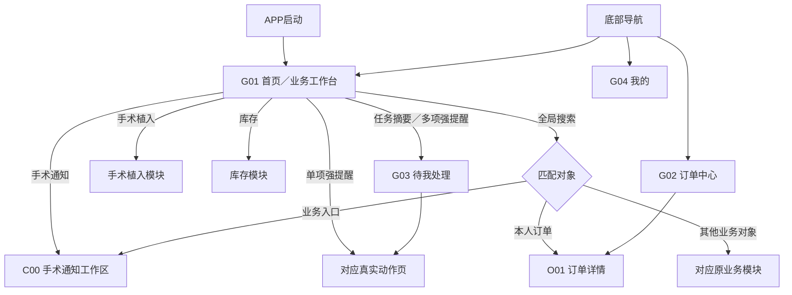

全局搜索只提供快捷导航，不建立独立业务事实或第三套订单列表。G04本阶段只保留设置型管理外壳。

## 3. 手术通知总体流程

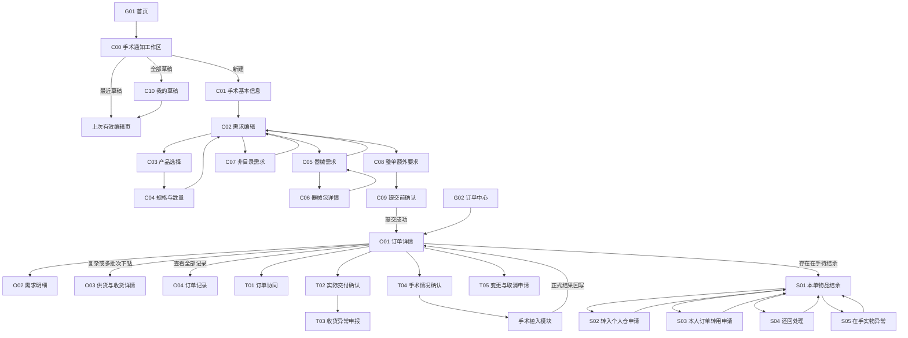

总图只表达主要连接关系，不表示所有页面必然依次经过。具体条件、返回位置和等待状态以下列PF线路为准。

## 4. PF01 新建手术通知

### 4.1 主路径


提交成功后给予明确的短反馈并进入O01，不单独建立“提交成功页”。

### 4.2 需求编辑往返

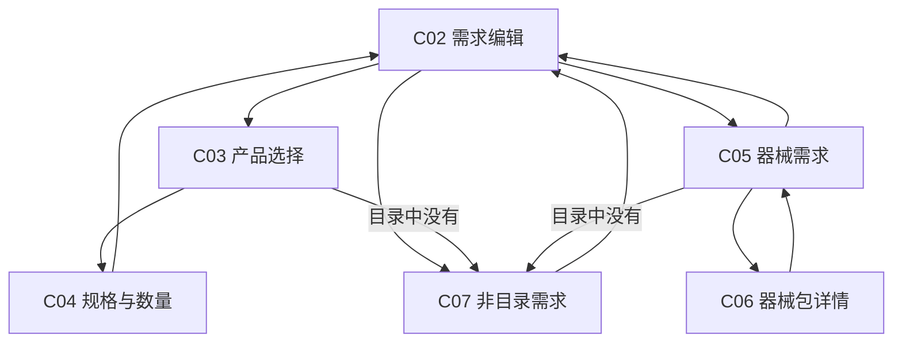

流程规则：

- 产品和器械可以单独申请，但提交时不能同时为空；
- C01必须填写医院、科室、术者、手术日期和准确时间；
- 每次完成一种产品的规格和数量后回到C02汇总，不强迫连续选择下一种；
- 是否采用系统推荐器械包由业务员自主选择；查看C06本身不改变选择；
- 非目录产品和非目录器械共用C07，但必须保留需求类型；
- 业务员可以多次往返C02，完成后自行进入C08。

### 4.3 修改、失败和退出

- C09各内容区可以回到对应页面修改，保存后重新回到C09；
- 校验失败停留在C09，指出具体问题并提供回到相应页面的入口；
- 疑似重复只提醒，不阻止继续提交；
- 网络失败或重复点击不得产生两张订单，当前输入和草稿必须保留；
- C01—C09中途退出自动保存，不视为放弃；
- 正式提交使用唯一业务请求标识，防止重复订单。

## 5. PF02 草稿与历史需求复用

### 5.1 继续草稿


- C10只负责查找、继续和删除草稿，不放置“新建手术通知”按钮；
- 继续草稿恢复上次有效编辑位置，不一律从C01开始；
- 删除草稿需要二次确认，删除后留在C10并恢复原列表位置；
- 草稿来源包括空白新建、历史需求复用和待受理订单撤回。

### 5.2 按此需求新建


- 带入历史订单最后有效的医院、科室、术者、产品和器械需求；
- 新手术日期和准确时间必须重新填写；
- 非目录需求、特殊器械和整单额外要求必须重新核对；
- 当前基础信息已经停用、删除或无法映射的项目进入“历史需求待核对”，不静默丢弃；
- 不复制原订单身份、状态、履约、批次、实物、植入、本单物品结余、异常和任务；
- 第一阶段不提供保存模板或模板管理支线。

## 6. PF03 补充单、撤回与正式变更

### 6.1 发起补充单

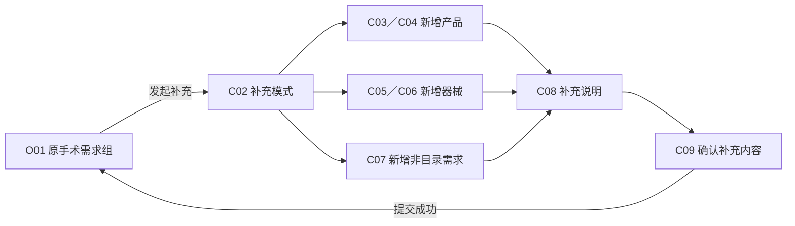

- 补充单继承原手术场景，C01只读或跳过；
- 补充单只新增需求，不覆盖原订单已经生效的内容；
- 提交后回到同一个O01，G02不增加一张同级订单卡；
- 原单和补充单仍分别编号、处理和审计。

### 6.2 待受理撤回


只有待受理阶段可以直接撤回。撤回后恢复为草稿，不把正式订单原地开放编辑；该草稿同时可以在C10中找到。

### 6.3 正式变更与取消


- 正式提交后的医院、科室、术者、时间、需求减少、停止剩余和订单取消都通过T05提请；
- 业务员提交申请不直接改写当前生效内容；
- 提交后只等待公司时不继续占据待我处理；
- 后台返回新问题时，根据真实动作生成新的任务或协同版本。

## 7. PF04 订单中心、详情与任务入口

### 7.1 正常浏览

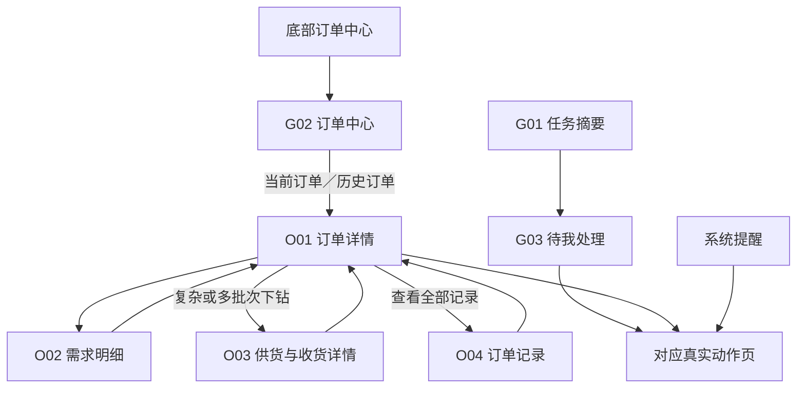

G02只分当前订单和历史订单，不设置“全部订单”或“待我处理”页签。每张卡只有一个主状态和最多一项必要提示，点击整张卡先进入O01。

### 7.2 O01动态任务

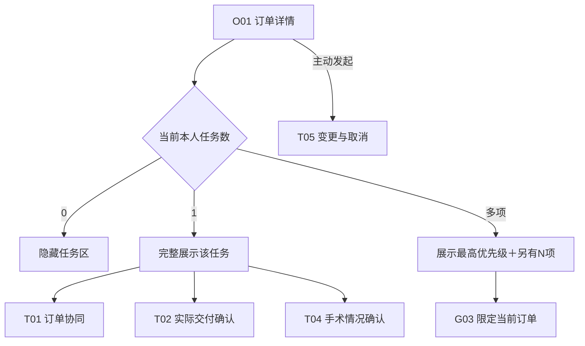

- T03只从T02进入，不直接占据O01任务区；
- T05主要是业务员主动操作，或承接T04延期／取消；
- 植入和本单物品结余任务可以出现在G03或O01必要入口，但仍进入各自原模块；
- G02只显示必要提示，不在订单卡叠加第二个直接处理按钮。

### 7.3 当前与历史

- 当前订单：待受理、处理中、待发货、已发货、发起追回、待结余；
- 历史订单：已完成、已取消；
- 计划时间到达不自动改变主状态；
- 部分发货、部分接收、补充单差异和还回阶段不新增列表状态；
- 历史订单的“按此需求新建”只在O01提供，不挤入G02卡片。

## 8. PF05 订单协同

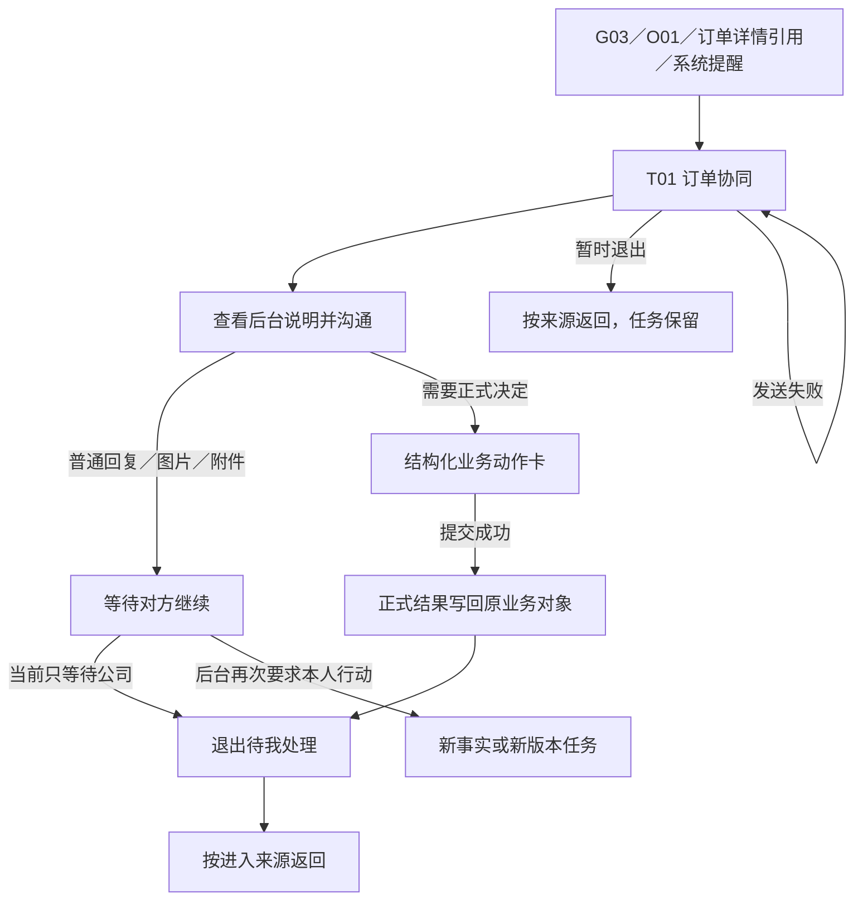

T01不再要求业务员识别“替代、规格、数量、非目录、时间或交付安排”等后台分类。

- 后台在当前条件下不能直接继续，需要业务员补充、沟通或决定时发起；
- 普通聊天内容只作辅助，不能直接改变正式订单事实；
- 正式变化必须由结构化业务动作形成；
- T01不能代替T02、T03、T04、T05、手术植入或本单物品结余；
- 内部货源变化和纯知晓信息不进入T01；
- 提交失败保留输入并允许安全重试；
- 同一事项不同入口引用同一任务，不重复生成。

## 9. PF06 分批交付、批次确认与收货异常

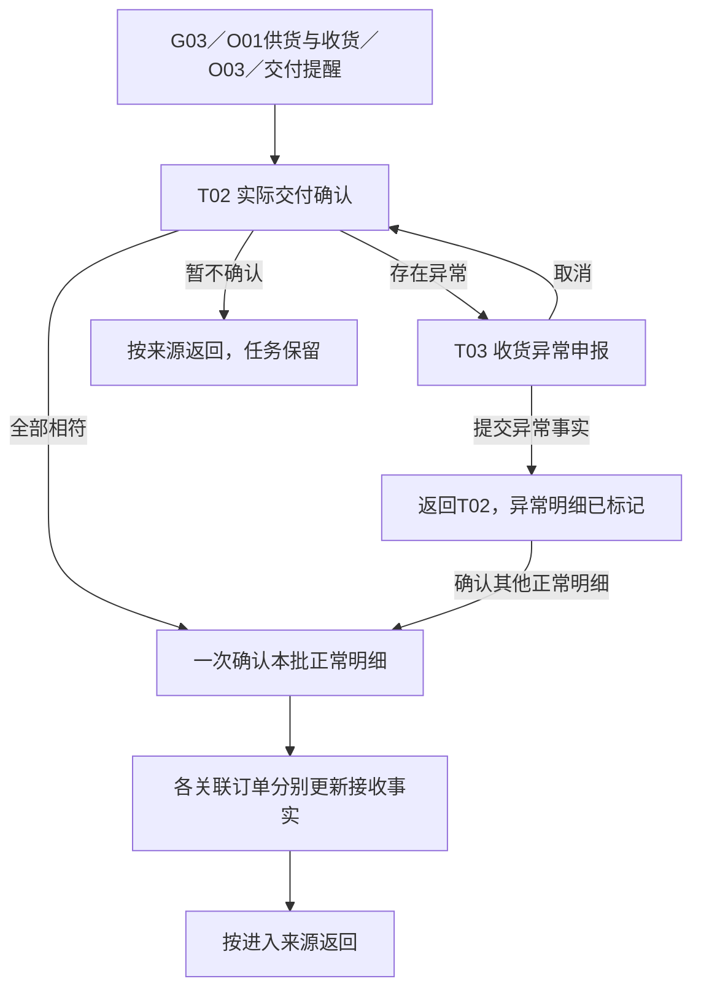

- T02按公司建立的一次实际交付批次组织，可以关联同一业务员的一张或多张订单；
- 业务员不能自行拼接没有共同交付关系的订单；
- 后台发货、物流或交接签收、业务员本人确认接收是三个独立事实；
- 正常明细可以确认，异常明细不能被同一次确认掩盖；
- T03只处理确认接收前、实际交付现场发现的异常；
- 公司在业务员接收前成功拦截时，只更新O01供货与收货区域及适用的O03复杂批次详情，不要求业务员收货或还回；
- 本人确认接收后建立在手责任，之后发现的异常进入S05。

## 10. PF07 手术时间到期后的结果衔接

计划手术时间到达或已经过去，不自动把订单标记为已进行、延期、取消或待结余。

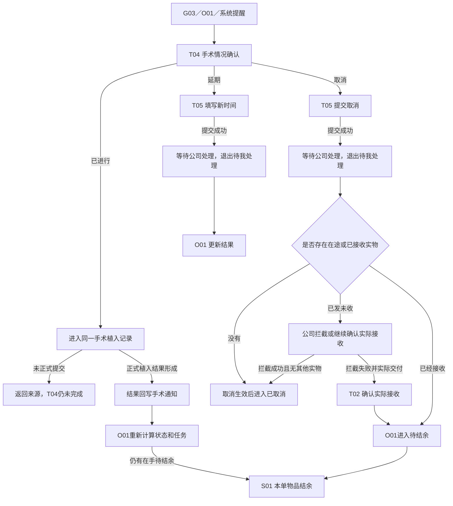

已进行路径：

- 跳转时携带来源手术通知并定位同一植入记录；
- 手术通知已交付物只作为候选，默认不全选；
- 患者信息、住院号和实际植入明细在植入模块采集；
- 进入过植入页面不等于结果已经形成；
- 有效植入结果正式提交后，T04才完成；
- 结果先回写O01，不强制业务员立即进入S01；只有仍有实物待结余时，O01或G03提供后续入口。

延期与取消：

- 延期不自动进入待结余，已接收实物继续绑定原订单；
- 尚未发货的剩余需求由后台处理停止；
- 已发未收先由后台尝试拦截，成功拦截不形成业务员还回责任；
- 已经由业务员确认接收的实物必须进入本单物品结余，不能因取消自动解除责任。

## 11. PF08 本单物品结余的并行去向

### 11.1 责任关系

产品按数量守恒：

```text
实际接收数量
= 实际植入数量
+ 批准转个人仓数量
+ 批准转本人其他订单数量
+ 公司确认还回数量
+ 批准异常处置数量
+ 在手待结余数量
```

器械包按具体包编号、完整性和可用结果逐包管理，不能与产品件数合并为一个总数。

### 11.2 页面流程

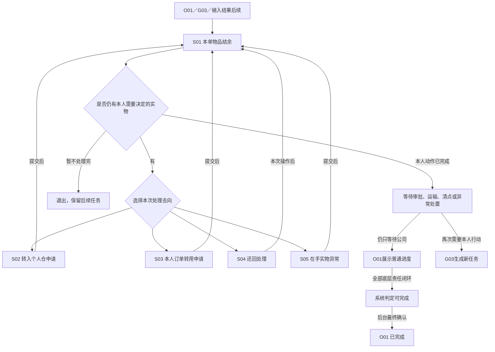

- 不同实物可以选择不同去向，四条路径没有固定先后；
- 同一订单可以分多次处理；
- 提交申请只表示进入审批或处置，不立即解除责任；
- 业务员完成本人动作、只等待公司时，任务退出G03，但底层责任仍可能阻塞订单完成；
- S01不设置业务员“完成订单”按钮；
- 订单完成还要满足需求、交付、植入或取消、数量守恒和后台最终确认。

## 12. PF09 本人订单转用与消毒衔接

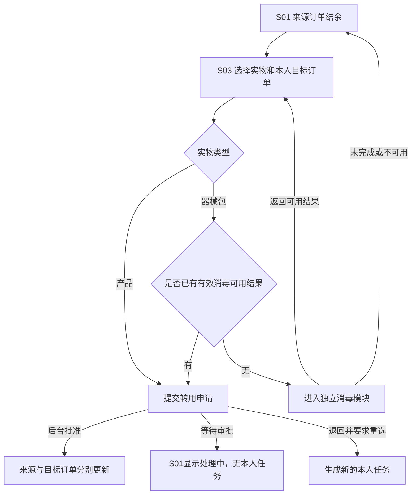

- 目标只能是同一业务员本人的明确有效订单；
- 产品落实到具体可追溯实物和数量，器械包落实到具体包编号；
- 没有明确目标订单时不能使用转用；
- 待审批时责任仍在来源订单，相关实物锁定；
- 严禁跨业务员转用；
- 消毒是独立模块，S03只读取必要结果。

## 13. PF10 还回处理与合并交接

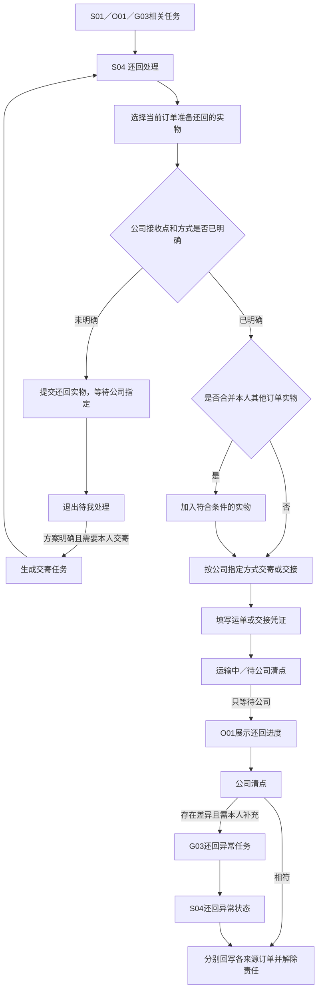

- S04属于原手术通知的还回分支，不形成首页独立模块；
- 一次寄送可以合并本人多张订单的还回实物；
- 合并的是物流交接，原订单、实物身份和责任仍分别存在；
- 接收方只能是公司指定接收点；
- 交寄后实物冻结，公司清点前不计入已还回；
- 运输中和等待公司清点不是业务员任务；
- 公司清点差异留在S04，不与T03或S05混用；
- 公司后续入库、调拨或退厂家属于Web后台流程。

## 14. PF11 在手实物异常

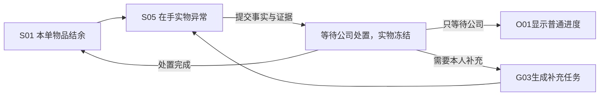

- 适用于本人确认接收后发生或发现的破损、污染、遗失、过期、包装或标签失效等；
- 申报后相关实物不能同时植入、转个人仓、转用或还回；
- 业务员只申报事实并查看结果，不自行判断报损、核销或责任归属；
- 公司正式处置完成后，S01才更新责任结果。

三类异常必须分开：

| 异常发生点 | 使用页面 |
|---|---|
| 实际交付当场、本人确认接收前 | T03 |
| 本人确认接收后、实物在手期间 | S05 |
| 本人交寄还回后、公司清点发现 | S04还回异常状态 |

## 15. 通用返回、退出与恢复

### 15.1 来源感知返回

| 进入来源 | 动作完成或退出后的默认返回 | 必须保留 |
|---|---|---|
| G01任务摘要或单项强提醒 | G01 | 首页工作现场和最新任务摘要 |
| G02订单列表 | G02原位置 | 当前／历史集合、搜索、筛选、排序和滚动位置 |
| G03待我处理 | G03原位置 | 筛选、排序、滚动位置；完成任务退出当前列表 |
| O01 | 原O01 | 原订单、展开区域和剩余任务 |
| O01供货与收货或O03进入T02 | 原批次位置 | 当前批次上下文 |
| T03 | 固定返回原T02 | 原批次和已标记异常明细 |
| T04进入T05 | 返回T04最初来源 | 来源订单或任务上下文 |
| T04进入手术植入 | 返回最初来源或O01 | 同一植入记录和来源订单 |
| S01进入S02—S05 | 返回原S01 | 来源订单和当前结余位置 |
| 系统推送或无来源深链 | O01 | 关联订单及动作后的结果 |

系统返回键和页面返回按钮返回业务上的上一层，不无故跳回首页。

### 15.2 创建与表单恢复

- C03—C07完成或返回后回到C02；
- C08正常返回C02；
- C09进入修改页，保存后回到C09；
- O02—O04返回O01；
- 未提交的创建、异常、变更和还回表单保留本机草稿；
- 网络中断、APP切后台或意外退出后恢复最近有效步骤；
- 加载失败与暂无数据必须区分，并提供明确重试或返回路径；
- 已经成功提交的正式事实不能通过返回键回滚。

### 15.3 防重复与重要确认

- 正式提交使用唯一业务请求标识；
- 重复点击不能产生重复订单、确认、申请、异常或交寄记录；
- 删除草稿、撤回、取消和确认接收等重要动作需要明确确认；
- 提交中、成功和失败必须有清楚反馈；
- 失败后保留用户已填写内容，允许安全重试。

### 15.4 深链与跨模块

跨页面或跨模块至少携带：

- 当前公司和业务员；
- 来源订单或聚合引用；
- 来源对象及版本；
- 任务ID；
- 来源页面与返回目标。

原模块重新校验权限和有效版本。同一任务不因多个入口重复生成，跨模块只交换必要结果，不复制完整流程。

## 16. 29页覆盖检查

| 页面组 | 页面 | 主要进入流程 |
|---|---|---|
| G | G01 | 全局入口、任务摘要、搜索 |
| G | G02 | PF02历史复用、PF04订单查询 |
| G | G03 | PF04动态任务及PF05—PF11适用任务 |
| G | G04 | 底部全局设置入口，本阶段外壳 |
| C | C00 | PF01新建、PF02草稿 |
| C | C01—C09 | PF01创建、PF02复用、PF03补充与撤回 |
| C | C10 | PF02全部草稿 |
| O | O01—O04 | PF02—PF11订单聚合、详情和记录 |
| T | T01 | PF05订单协同 |
| T | T02—T03 | PF06实际交付与收货异常 |
| T | T04—T05 | PF03正式变更、PF07手术情况 |
| S | S01—S05 | PF08—PF11本单物品结余及分支 |

关键场景覆盖：

| 业务场景 | 页面流程 |
|---|---|
| 首页进入手术通知工作区 | G01→C00 |
| 新建要货并提交 | PF01 |
| 一天创建多张独立通知 | PF01、PF02，分别形成草稿和订单 |
| 详细产品规格数量 | PF01的C03—C04 |
| 自主选择推荐器械包 | PF01的C05—C06 |
| 非目录产品或器械 | PF01的C07 |
| 草稿续填 | PF02的C10 |
| 历史需求一次性复用 | PF02“按此需求新建” |
| 受理后追加需求 | PF03补充单 |
| 待受理撤回与正式变更 | PF03 |
| 当前与历史订单查询 | PF04 |
| 后台代建、替代、规格数量或交付沟通 | PF05 |
| 多订单同批交付 | PF06 |
| 交付现场部分异常、部分正常 | PF06 |
| 已进行、延期或取消 | PF07 |
| 植入只使用部分候选实物 | PF07 |
| 植入后多种去向并行处理 | PF08 |
| 转入个人仓 | PF08的S02 |
| 本人订单转用 | PF09 |
| 器械包消毒后转用 | PF09跨消毒模块 |
| 多订单实物合并送回公司 | PF10 |
| 在手实物异常 | PF11 |
| 本人动作结束但仍等待公司 | PF05、PF08—PF11 |
| 全部责任闭环后完成 | PF08，由系统判断、后台确认 |

覆盖结论：29个正式页面均有明确入口或全局页面身份；没有新增模板、采购、调拨、独立还回、独立消毒或后台内部作业页面。

## 17. 本稿刻意不决定

本稿不决定：

- 每页字段的具体排布和信息层级；
- 卡片、按钮、弹窗、抽屉和筛选面板的具体形态；
- 强提醒、搜索栏和任务摘要的视觉表达；
- 颜色、字体、间距、图标和动效；
- G03和G04内部页面结构；
- Web后台具体页面；
- 手术植入、库存和消毒模块内部页面。

这些事项不能通过页面设计静默改变当前规则。设计中发现业务矛盾时，必须先回到规则文件记录变更，再调整流程。

## 18. v0.3相对旧流程的变化

1. 正式页面由31页调整为29页，删除C11、C12模板支线；
2. 首页通过C00进入新建和草稿，不把草稿放回首页；
3. G01加入全局搜索导航，但不新增固定搜索结果业务页；
4. G02只承载当前订单和历史订单，G03仍是唯一全局任务集合；
5. 历史订单只保留“按此需求新建”；
6. T01从重要调整确认重构为订单协同，不再按后台问题类型让业务员做分类题；
7. O01以主状态、关键结果和动态任务为中心；
8. “待清算、待还回”统一为“待结余”，还回成为S04分支；
9. 植入结果形成后先回写O01，不强制立即跳S01；
10. 任务提交后只等待公司时退出G03，底层责任继续由订单记录；
11. 补充了公司接收方案未明确时的还回分段流程；
12. 返回、深链、表单恢复和防重复规则统一到来源上下文。

## 19. 当前结论

手术通知APP不是“新建—发货—植入—还回”的单一路径，而是三个相互衔接的业务阶段：

1. 业务员在C组提交缺口需求，形成手术需求组；
2. 公司处理期间，业务员通过O01和全局任务中心，只处理确实需要本人行动的事项并确认真实交付；
3. 手术结果形成或取消后，在S01中把已接收实物分别落实合法去向，直至系统满足完成资格并由Web后台最终确认。

本文件是下一阶段页面设计总控和低保真修改的当前线路依据。逐页设计必须服从本流程的入口、返回、分支和跨模块边界。
